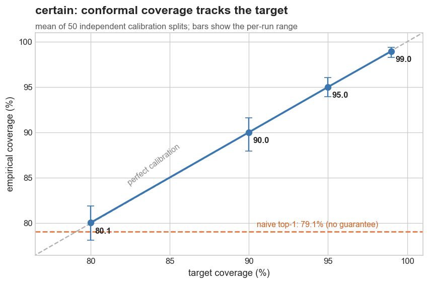

# certain

[](https://github.com/ss1738/certain/actions/workflows/ci.yml)
[](https://pypi.org/project/certain-conformal/)
[](LICENSE)

**Calibrated confidence and abstention for model outputs.** A softmax number
isn't a probability you can trust. certain turns any score into a **prediction set
with a coverage guarantee** (the true label is inside with probability >= 1-alpha,
distribution-free) or an **answer/abstain gate** with a controlled error rate.
Model-agnostic, works over LLM logprobs, judge scores, classifier probabilities,
retrieval scores. Pure Python, zero dependencies.

```python
from certain import ConformalClassifier

clf = ConformalClassifier(alpha=0.1)             # want 90% coverage
clf.calibrate(cal_scores, cal_labels)            # a held-out calibration split

clf.predict_set({"cat": 0.9, "dog": 0.05, "fox": 0.05})   # a singleton set -> confident, answer
clf.predict_set({"cat": 0.4, "dog": 0.35, "fox": 0.25})   # a larger set    -> unsure, flag
```

A singleton set means the model is confident enough to trust; a larger set is a
calibrated "not sure between these"; an empty set is "not confident about
anything", a principled abstention, not a coin flip.

## Why not just use the softmax?

Modern models are miscalibrated and usually overconfident: a "0.9" is not a 90%
chance of being right, and taking the top label gives you whatever the model's
accuracy happens to be, with no guarantee. Conformal prediction fixes the *output*
without retraining the model: from a small calibration set it computes a threshold
so that the returned set covers the truth at least at your target rate.

## Benchmark: the guarantee holds

`benchmarks/bench_coverage.py`: 5-class problem, 4,000 calibration / 4,000 test:

| Target coverage | Empirical | Avg set size |
|---|---|---|
| 99% | 98.6% | 3.96 |
| 95% | 94.3% | 2.71 |
| 90% | 88.6% | 1.84 |
| 80% | 78.6% | 1.12 |



Naive top-1 coverage is just its accuracy, **78.2%, with no guarantee**.
Conformal coverage tracks the target you ask for, and the set size tells you how
much the model actually knows at that confidence level.

## Selective answering (abstain when unsure)

```python
from certain import SelectiveAnswerer

gate = SelectiveAnswerer(target_error=0.1)       # answer only if <=10% error
gate.calibrate(confidences, correct)             # (conf, was_correct) pairs

gate.answer(0.95)   # True  -> answer it
gate.answer(0.40)   # False -> abstain
gate.evaluate(confidences, correct)              # {'coverage': ..., 'error_on_answered': ...}
```

`SelectiveAnswerer` controls empirical error on answered items; for a strict
distribution-free bound use `ConformalClassifier`, which carries the finite-sample
coverage guarantee.

## API

- **`ConformalClassifier(alpha=0.1)`**: `.calibrate(score_rows, labels)`,
  `.predict_set(scores)`, `.predict(scores)`, `.evaluate(score_rows, labels)`.
- **`SelectiveAnswerer(target_error=0.05)`**: `.calibrate(confidences, correct)`,
  `.answer(confidence)`, `.evaluate(...)`.

Scores are any non-negative per-label values (probabilities, exponentiated
logprobs, judge scores); they're normalised internally.

## Install

```bash
pip install certain-conformal      # or: pip install -e . from a clone
```

Python ≥ 3.9, no runtime dependencies.

## References

Vovk, Gammerman & Shafer, *Algorithmic Learning in a Random World*; Angelopoulos &
Bates, *A Gentle Introduction to Conformal Prediction* (2021).

## Related

Part of a set of four small libraries for not trusting an unverified LLM output:

- [stigma](https://github.com/ss1738/stigma): aggregate many models with consensus that learns which to trust
- [disco](https://github.com/ss1738/disco): search with a verifier (an open FunSearch)
- [groundkit](https://github.com/ss1738/groundkit): ground a model's output against a source
- **certain** (this repo): calibrate confidence and abstain

## License

MIT © 2026 Satyawan Singh
